# Labs64.IO :: Workspace

**Work on the whole Labs64.IO Ecosystem from source, in one command.**
*Part of the [Labs64.IO Ecosystem](https://labs64.io): the contributor entry point: every repository, one toolchain, one local platform.*

[**Get started**](https://labs64.io/docs/getting-started/run-the-full-ecosystem-locally.html) · [Features](#features) · [AI agents](#using-workspace-with-ai-agents) · [Ecosystem](#the-labs64io-ecosystem) · [Documentation](https://labs64.io/docs/development/) · [labs64.io](https://labs64.io)

> [!NOTE]
> Labs64.IO is ten independent Git repositories, not a monorepo. If you only want to **see** it running you do not need the workspace: use `install.sh`.

## Why Workspace?

Changing a platform that spans many repositories means the same toolchain, the same pinned versions and a local cluster that behaves like the real thing. Setting that up by hand is a day you do not get back; Workspace makes it a command.

1. **One checkout command.** `just clone` fetches every ecosystem repository next to the workspace.
2. **One pinned toolchain.** A dev container carries every tool at the version the repositories expect.
3. **One local platform.** `just up` builds every first-party image and deploys it to a k3d cluster; `just smoke` checks it.

**A good fit if**

- You are about to change code in one or more Labs64.IO repositories and want a working environment fast.
- You review pull requests that span repositories.
- You want an AI agent to work across the ecosystem with the same tools you have.

**Probably not what you need if**

- You only want to see Labs64.IO running: `install.sh` is quicker and needs no checkouts.
- You are using one module in your own project: use that module's Docker or Kubernetes option instead.

## Features

- **Multi-repo bootstrap**: `just clone` fetches every ecosystem repository next to the workspace.
- **Pinned dev container**: every tool at the version the repositories expect, with Docker-outside-of-Docker.
- **Local platform**: `just up` builds first-party images in a builder container and deploys them to k3d with a local registry.
- **Smoke tests**: `just smoke` checks the running platform through the gateway.
- **Knowledge graph and AI skills**: a graph of the ecosystem and skills for agents working across repositories.
- **Version and release tooling**: pin checks, release and dependency-update recipes.

## Is this the right place to start?

| You want to… | Start here |
|---|---|
| **See Labs64.IO running** and call an API | You do not need this workspace: the [Quickstart](https://labs64.io/docs/getting-started/quickstart.html) installs published images in about five minutes |
| **Try one service** without Kubernetes | [Run one module locally](https://labs64.io/docs/getting-started/run-one-module-locally.html) |
| **Deploy for your team** on AWS, Azure, Google Cloud or your own cluster | [Deploy to your Kubernetes cluster](https://labs64.io/docs/getting-started/deploy-to-kubernetes.html) |
| **Change the code**, build from source, contribute | You are in the right place |

## Using Workspace with AI agents

Workspace is where an agent gets the same environment a human contributor has.

- **One entry point.** Every build, deploy and test is a `just` recipe run from `labs64.io-workspace/`; `just` lists them by group, and `just helm-charts` / `just tests` list those repositories' recipes. The same name means the same thing in every repository ([`docs/justfiles.md`](docs/justfiles.md)).
- **Cross-repo knowledge.** The workspace carries a knowledge graph and skills so an agent can follow a change across repositories.
- **Verify before proposing.** `just ci` in the repository you changed runs what its pull-request check runs; `just smoke` checks the running platform.
- **Working on the code with an agent?** [`AGENTS.md`](AGENTS.md) and [`CLAUDE.md`](CLAUDE.md) describe the layout and conventions.

## The Labs64.IO Ecosystem

Workspace is one module of the [Labs64.IO Ecosystem](https://labs64.io); [every module is documented here](https://labs64.io/docs/).

| Module | What it does | Link |
|---|---|---|
| **AuditFlow** | Audit-event routing pipeline | [labs64.io-auditflow](https://github.com/Labs64/labs64.io-auditflow) |
| **API Gateway** | Authenticating, policy-enforcing edge for all modules | [labs64.io-authproxy](https://github.com/Labs64/labs64.io-authproxy) |
| **Payment Gateway** | One API over multiple payment providers | [labs64.io-payment-gateway](https://github.com/Labs64/labs64.io-payment-gateway) |
| **Checkout** | Embeddable, brandable checkout | [labs64.io-checkout](https://github.com/Labs64/labs64.io-checkout) |
| **Customer Portal** | Customer self-service UI | [labs64.io-customer-portal](https://github.com/Labs64/labs64.io-customer-portal) |
| **Commons** | Shared Java and Python libraries | [labs64.io-commons](https://github.com/Labs64/labs64.io-commons) |
| **Helm Charts** | Kubernetes deployment for every module | [labs64.io-helm-charts](https://github.com/Labs64/labs64.io-helm-charts) |
| **Workspace** | Dev container and multi-repo tooling | [labs64.io-workspace](https://github.com/Labs64/labs64.io-workspace) |
| **Tests** | Cross-module regression suite | [labs64.io-tests](https://github.com/Labs64/labs64.io-tests) |
| **Docs** | Published documentation | [labs64.io-docs](https://github.com/Labs64/labs64.io-docs) |
| **NetLicensing** | Licensing-as-a-Service: license and entitlement management | [netlicensing.io](https://netlicensing.io) |
| **GuideChimp** | Interactive guided product tours | [labs64.com/guidechimp](https://www.labs64.com/guidechimp/) |

## Contributing

We would love your help. The workspace is where contributors spend their first hour, so every rough edge you smooth here helps the next person. Fork the repository, make your change on a branch, run the checks described in [`AGENTS.md`](AGENTS.md) and open a pull request. Not sure whether an idea fits? Open an issue first and we will talk it through; that is a perfectly good way to start.

## License

Everything in this repository is open source under the [Apache License 2.0](LICENSE): you can use it, change it and ship it commercially. The core of the *Labs64.IO Ecosystem* is free forever; community modules are Apache-2.0 licensed.

---

   
  Made by the <a href="https://labs64.io">Labs64</a> team and community.

