# Labs64.IO :: Workspace

**Work on the whole Labs64.IO Ecosystem from source, in one command.** Workspace is the contributor entry point: `just clone` fetches every ecosystem repository next to it, a dev container carries every tool at the version the repositories expect, and `just up` builds every first-party image and deploys it to a local k3d cluster. Labs64.IO is a set of independent Git repositories, not a monorepo.

## The Labs64.IO Ecosystem

The workspace is part of the [Labs64.IO Ecosystem](https://labs64.io). Its documentation is at [labs64.io/docs/development/workspace-repositories](https://labs64.io/docs/development/workspace-repositories.html); [all modules are listed in the documentation](https://labs64.io/docs/services/).

---

   
  Made by the <a href="https://labs64.io">Labs64</a> team and community.

